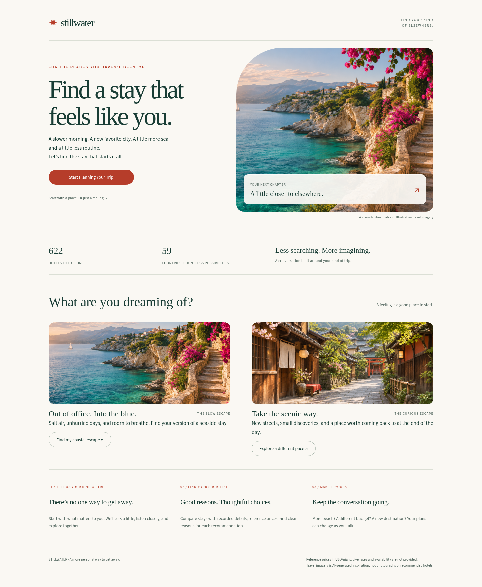
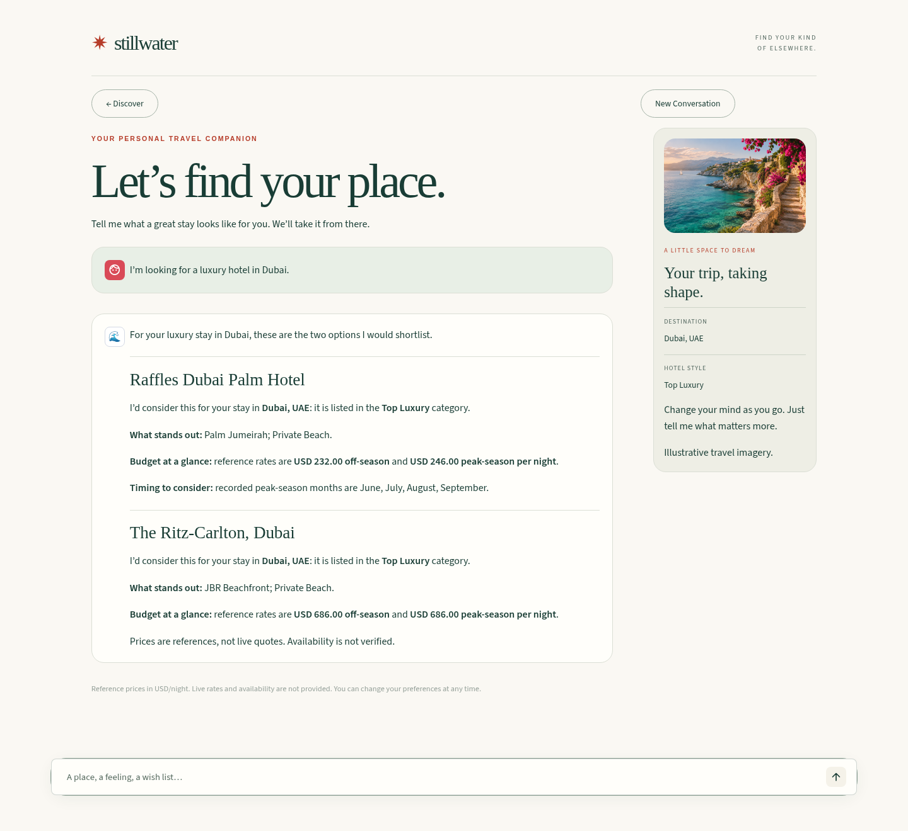
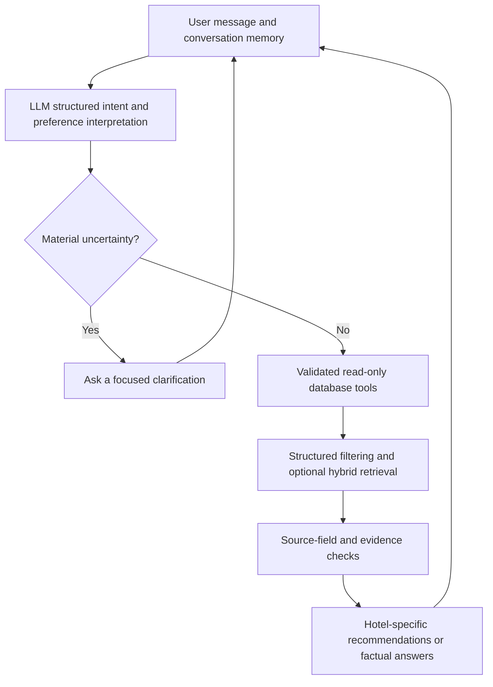

# Stillwater — Conversational Travel AI Agent

**Find a stay that feels like you.**

Stillwater is a conversational AI travel assistant that helps users find hotels based on their destination, budget, and personal preferences. It combines an LLM with a hotel database to provide recommendations and answer questions about the available hotel records.

Users can describe the trip they have in mind, refine their preferences, compare hotels, and ask follow-up questions through a Streamlit chat interface.

View the chat interface

The chat screenshot is a UI demonstration using actual dataset records, not a reported LLM evaluation result.

## What you can do

- **Plan through conversation:** start with a destination, a budget, or a travel experience and refine it over multiple turns.
- **Get personalized recommendations:** filter by recorded location, brand, hotel tier, price, and supported features.
- **Clarify important ambiguity:** distinguish an uncertain preference from a confirmed requirement, without inventing a numerical budget.
- **Keep context:** update preferences, remove requirements, and refer to “the first hotel” or “those options.”
- **Ask database questions:** retrieve hotel details, compare reference prices, check recorded seasonal months, and calculate counts, averages, minimums, maximums, or grouped results.
- **Understand the trade-offs:** see recorded highlights, reference rates, estimated-price disclosures, and details the dataset cannot establish.

The included dataset contains **622 hotels across 59 countries and 141 cities**. 
## How it works

## Data and boundaries

The authoritative inputs are:

- [`cleaned_hotels.csv`](cleaned_hotels.csv): hotel locations, recorded brands and tiers, labels, descriptions, benefits, seasonal information, and reference prices.
- [`Travel_AI_Agent_Evaluation_Rubric_v1.docx`](Travel_AI_Agent_Evaluation_Rubric_v1.docx): the evaluation specification.

Prices are **USD per night reference values**, not live booking quotes. Some fields are missing, and one record is flagged as having estimated prices. Missing amenities or months remain unknown; the app does not infer that a feature is absent or that a hotel has no seasonality.

The dataset cannot establish live availability, booking guarantees, current promotions, unrecorded amenities, or unrecorded distances. For a hard budget with unknown seasonality, the application conservatively checks the higher recorded rate and excludes estimated-price records.

Sessions are isolated in Streamlit memory. They are not persistent accounts and may be lost when a browser session or server is restarted. Very long conversations are also bounded by the configured model's context window.
