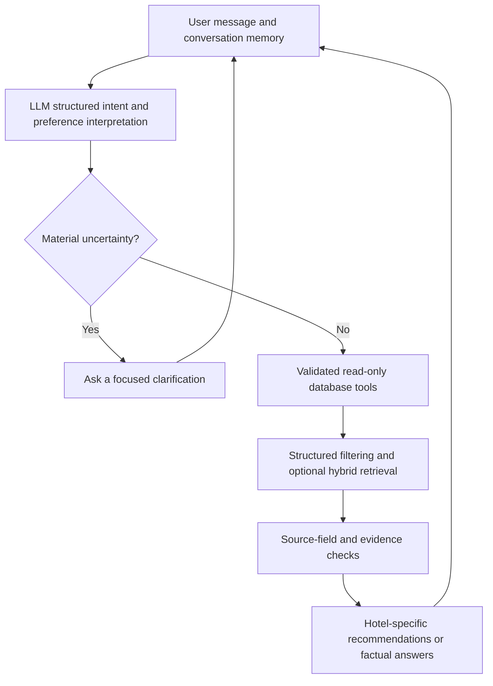

# Stillwater — Conversational Travel AI Agent

**Find a stay that feels like you.**

Stillwater is an LLM-powered hotel recommendation and database question-answering application. It turns a conversation about destinations, budgets, and travel preferences into a shortlist of hotels, with explanations grounded in the included hotel dataset.

Built with Python and Streamlit, it combines structured intent interpretation, conversation memory, read-only database tools, hybrid retrieval, and evidence checks. Users can refine their plans, compare previous recommendations, and ask follow-up questions without starting over.


<details>
<summary>View the chat interface</summary>


The chat screenshot is a UI demonstration using actual dataset records, not a reported LLM evaluation result.

</details>

## What you can do

- **Plan through conversation:** start with a destination, a budget, or a travel experience and refine it over multiple turns.
- **Get personalized recommendations:** filter by recorded location, brand, hotel tier, price, and supported features.
- **Clarify important ambiguity:** distinguish an uncertain preference from a confirmed requirement, without inventing a numerical budget.
- **Keep context:** update preferences, remove requirements, and refer to “the first hotel” or “those options.”
- **Ask database questions:** retrieve hotel details, compare reference prices, check recorded seasonal months, and calculate counts, averages, minimums, maximums, or grouped results.
- **Understand the trade-offs:** see recorded highlights, reference rates, estimated-price disclosures, and details the dataset cannot establish.

The included dataset contains **622 hotels across 59 countries and 141 cities**. No database upload is required.

## Quick start

### 1. Get the project

Clone the repository, or download and extract its ZIP:

```bash
git clone https://github.com/Isa-bellllla/Travel-agent.git
cd Travel-agent
```

Run the following commands from the project root—the folder containing `app.py`.

### 2. Install dependencies

**Python 3.12 is the tested version.** A virtual environment is recommended.

On macOS or Linux:

```bash
python3 -m venv .venv
source .venv/bin/activate
python -m pip install -r requirements.lock
```

On Windows PowerShell:

```powershell
py -3.12 -m venv .venv
.\.venv\Scripts\Activate.ps1
python -m pip install -r requirements.lock
```

`requirements.lock` pins the tested dependency versions. `requirements.txt` lists the direct dependencies with version ranges.

### 3. Configure your language model

The application supports an OpenAI-compatible API or local Ollama inference. **The supplied `.env.example` defaults to Ollama.** To use an OpenAI API key, create a file named `.env` beside `app.py` and use:

```dotenv
LLM_PROVIDER=openai
LLM_MODEL=gpt-4.1
OPENAI_BASE_URL=https://api.openai.com/v1
OPENAI_API_KEY=your_api_key_here
ALLOW_PAID_API=true
EMBEDDING_MODEL=
LLM_TIMEOUT=120
```

Use an API model ID available to your account. The provider must support JSON-schema response formatting; a model's display name in a chat application may differ from its API ID.

- Keep your key in `.env` or environment variables. `.env` is excluded by `.gitignore`.
- Do not commit API keys or overwrite an existing private `.env` without checking its contents.
- API-backed chat and model evaluation can incur charges. Hosted calls are disabled unless `ALLOW_PAID_API=true`.
- Leave `EMBEDDING_MODEL` empty for the default retrieval baseline; an embedding API key is not required.

Environment variables already set in your terminal or notebook take precedence over `.env`. Restart the website after changing configuration.

### 4. Start the website

With the virtual environment active:

```bash
python -m streamlit run app.py
```

Open the local URL printed in the terminal. Use **Start Planning Your Trip** to enter the chat, and **New Conversation** to reset the session. Stop the server with `Ctrl+C`.

The homepage can load without a configured model. Sending a message requires a reachable model with valid configuration.

## Run from Jupyter Notebook

If you use Jupyter locally, open **[`Start_Travel_Agent.ipynb`](Start_Travel_Agent.ipynb)** in the project root and run its cells in order.

The notebook:

1. Checks the project directory and prints the build version.
2. Installs the pinned dependencies in the notebook's Python environment.
3. Accepts an API model ID and a hidden API key.
4. Starts the website in a fresh process on an available port.
5. Displays a clickable link and attempts to open your browser.
6. Provides optional test, evaluation, and stop-server cells.

The key is kept in the notebook kernel's environment; the configuration cell does not save or print it. Rerun that cell after restarting the kernel, then relaunch the website.

The automatic local browser link is intended for Jupyter running on the same computer as your browser. Hosted notebook services require their own server preview or proxy URL.

## Local inference with Ollama

For an alternative to paid API inference, install [Ollama](https://ollama.com/download) and choose a model suitable for your hardware. The project's default local configuration uses `qwen2.5:3b`.

Start the server:

```bash
ollama serve
```

In another terminal, download the model:

```bash
ollama pull qwen2.5:3b
```

Use the following `.env` settings:

```dotenv
LLM_PROVIDER=ollama
OLLAMA_BASE_URL=http://127.0.0.1:11434
LLM_MODEL=qwen2.5:3b
ALLOW_PAID_API=false
EMBEDDING_MODEL=
LLM_TIMEOUT=120
```

Then start Streamlit as above. Model download access, memory requirements, response quality, and latency depend on the selected model and your machine.

### Optional local neural embeddings

When using the **Ollama provider**, you can enable neural embedding retrieval:

```bash
ollama pull nomic-embed-text
```

Set `EMBEDDING_MODEL=nomic-embed-text` and restart the app. Embeddings are cached in `.cache/`, keyed by dataset hash, embedding model name, and endpoint. Clear the cache if you replace a model behind the same name.

With `EMBEDDING_MODEL` empty, retrieval uses TF-IDF and local latent semantic analysis (LSA), alongside structured filters and evidence checks. This statistical baseline does not require a model download and should not be described as pretrained neural embeddings. The current neural embedding integration uses the Ollama provider; leave this setting empty when using the OpenAI provider.

## Try a conversation

For example, start with:

> I'm looking for a luxury hotel in Dubai.

Then refine or ask about the results:

> My budget is low.
>
> No more than $300 per night.
>
> Which of those is cheapest during peak season?
>
> Tell me more about the second one.

You can also ask direct database questions:

> What is the average off-season reference price of hotels with Hyatt in their recorded brand name?
>
> When is peak season for Raffles Dubai Palm Hotel?
>
> How many hotel records are there in each city?

These are example inputs, not fixed response scripts or guaranteed benchmark outcomes.

## How it works



The LLM interprets meaning and selects tools; deterministic operations handle filters and calculations. The application never executes unrestricted model-generated SQL or Python.

Field meaning matters: a hotel-tier request is checked against **Brand level**, not any occurrence of “luxury” in a description. A neighboring property's amenity does not establish that the recommended hotel has it. Embedding similarity can help rank candidates, but does not prove a hotel fact.

Conversation state stores confirmed and tentative preferences, replacements, budgets, pending and resolved clarifications, hotel references, and history. Shared location/tier requirements are introduced once, while each hotel is presented through its own recorded features. A recommendation does not end the conversation; the user can continue, change direction, or finish.

## Data and boundaries

The authoritative inputs are:

- [`cleaned_hotels.csv`](cleaned_hotels.csv): hotel locations, recorded brands and tiers, labels, descriptions, benefits, seasonal information, and reference prices.
- [`Travel_AI_Agent_Evaluation_Rubric_v1.docx`](Travel_AI_Agent_Evaluation_Rubric_v1.docx): the evaluation specification.

Prices are **USD per night reference values**, not live booking quotes. Some fields are missing, and one record is flagged as having estimated prices. Missing amenities or months remain unknown; the app does not infer that a feature is absent or that a hotel has no seasonality.

The dataset cannot establish live availability, booking guarantees, current promotions, unrecorded amenities, or unrecorded distances. For a hard budget with unknown seasonality, the application conservatively checks the higher recorded rate and excludes estimated-price records.

Sessions are isolated in Streamlit memory. They are not persistent accounts and may be lost when a browser session or server is restarted. Very long conversations are also bounded by the configured model's context window.

Travel images are bundled AI-generated illustrations, not photographs of recommended hotels. See [`assets/README.md`](assets/README.md).

For the complete schema and data-quality audit, see [`docs/schema_report.md`](docs/schema_report.md).

## Tests and evaluation

Run the automated suite without making model API calls:

```bash
python -m pytest -q
```

Additional deterministic checks:

```bash
python scripts/audit.py
python -m scripts.benchmark
```

To record conversations with your **actual configured model**:

```bash
python -m evaluation.run --split development --output evaluation/runs/development.json
python -m evaluation.run --split regression --output evaluation/runs/regression.json
python -m evaluation.run --split acceptance --output evaluation/runs/acceptance.json
```

After freezing the model, prompts, and pipeline, run the held-out scenarios:

```bash
python -m evaluation.run --split held_out --output evaluation/runs/held_out.json
```

These model-backed runs can incur API charges. Traces include plans, preferences, query parameters, hotel IDs, evidence, responses, and timings. They can contain conversation text; review them before sharing.

The official rubric scores **factual accuracy (A), recommendation relevance (B), and intent understanding (C)**. Initial clarification turns have B marked N/A; completed multi-turn cases use cumulative clarified preferences. Latency and memory diagnostics are reported separately. Subjective criteria require review rather than automatic passing scores.

See [`evaluation/README.md`](evaluation/README.md) for annotation instructions. To summarize a reviewed score file:

```bash
python -m evaluation.run --score-file evaluation/runs/annotated.json
```

**Validation scope:** automated tests cover database operations, state transitions, tool contracts, grounding checks, rendering, scoring formulas, and UI flows. Tests with queued model outputs do not establish real LLM generalization. Real conversational quality, evidence entailment, optional neural retrieval, and clarification latency must be evaluated with the deployed model. Recorded results and remaining limits are documented in [`docs/performance_report.md`](docs/performance_report.md).

## Project structure

```text
Travel-agent/
├── app.py                         # Streamlit homepage and chat interface
├── Start_Travel_Agent.ipynb        # Local Jupyter configuration and launcher
├── travel_agent/                  # Interpretation, memory, tools, retrieval, grounding
├── evaluation/                    # Scenarios, actual-model runner, rubric summaries
├── tests/                         # Component and UI regression tests
├── assets/                        # Local travel imagery and UI styles
├── .streamlit/config.toml         # Light theme configuration
├── docs/                          # Schema, architecture, reports, and change notes
├── cleaned_hotels.csv
├── Travel_AI_Agent_Evaluation_Rubric_v1.docx
├── requirements.txt
├── requirements.lock
├── .env.example
└── VERSION
```

## Troubleshooting

| Problem | What to check |
|---|---|
| “Your travel consultant is temporarily unavailable” | Confirm `LLM_PROVIDER`, the exact model ID, provider reachability, and credentials. For OpenAI, verify `ALLOW_PAID_API=true`; for Ollama, verify that the server and model are available. Also check your API account's access and quota. |
| An API key is set, but the app still tries Ollama | `.env.example` defaults to Ollama. Set `LLM_PROVIDER=openai`, then restart the website process. |
| Updated environment variables have no effect | A running child process does not receive later notebook/terminal changes. Relaunch the website after configuration. |
| `app.py` cannot be found | Run from the project root. In Jupyter, use `Path.cwd()` to check the working directory. |
| Port 8501 is occupied | Use `python -m streamlit run app.py --server.port 8502`, or use the notebook launcher, which chooses a free port. |
| The interface or wording still looks like an older version | Stop the old server, start from the updated project directory, and use the newly printed link. Start a New Conversation; old replies are not rewritten. |
| Images or styles are missing | Keep `assets/` and `.streamlit/` with the complete project. Do not copy only `app.py`. |

## Further reading

- [Architecture](docs/architecture.md)
- [Dataset schema and rubric interpretation](docs/schema_report.md)
- [Evaluation procedure](evaluation/README.md)
- [Measured validation report](docs/performance_report.md)
- [UI design and visual checks](docs/ui_redesign.md)

This project is a development and evaluation application. Authentication, durable user storage, booking integrations, and production deployment operations are not included.
